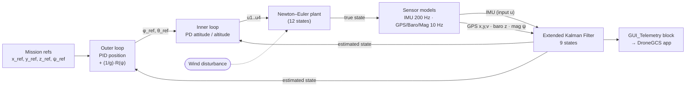

# X-Wing Quadcopter — Flight Control, Sensor Fusion & Data Acquisition

Design, simulation and hardware implementation of a **data acquisition (DAQ) system and cascaded autopilot for an X-wing VTOL quadcopter** — from Newton–Euler dynamics and pole-placement control, through a 9-state Extended Kalman Filter fusing realistic multi-rate sensor models, to Proteus-validated conditioning circuits and an ESP32 telemetry node streaming to a MATLAB ground-control GUI over USB and Bluetooth.

> Undergraduate project, **Instrumentation course**, Department of Electrical Engineering, Amirkabir University of Technology (Tehran Polytechnic) — July 2026.
> Supervisor: **Dr. Ahmad Afshar**.
> Full write-up: [`Report/PrjReport_Pashaei_Oleiaeemehr_MirKazemi_Group8.pdf`](Report/PrjReport_Pashaei_Oleiaeemehr_MirKazemi_Group8.pdf) (104 pages).

---

## Highlights

| Area | What was built | Key result |
|---|---|---|
| **Dynamics** | 12-state nonlinear Newton–Euler plant (`[x y z vx vy vz φ θ ψ p q r]`) | Implemented as a MATLAB Function block and as a standalone ODE (`quad_dynamics.m`) |
| **Inner loop** | PD attitude + altitude control by pole placement | Roll step: 5 % P.O., T<sub>p</sub> = 0.29 s · Altitude step: 4.1 % P.O., T<sub>p</sub> = 0.92 s |
| **Outer loop** | PID position control with yaw-rotated tilt commands, (1/g)·R(ψ) | Square-trajectory RMSE tuned 3.891 → 3.244 m; 2 m/s² wind rejected to zero steady-state error |
| **Estimation** | 9-state EKF, IMU-as-input / GPS + baro + magnetometer as measurements, multirate (200 Hz predict, 10 Hz correct) | Unmeasured roll and pitch reconstructed; GPS position noise reduced by ~1–2 orders of magnitude |
| **Sensor models** | GPS (with LLA → flat-Earth round-trip), IMU (body-frame specific force), barometer, magnetometer — NED ↔ z-up frame handling | Two measurement buses at physically faithful rates |
| **Electronics** | 6 conditioning circuits simulated in Proteus | 1.8 kΩ I²C pull-up sized from spec (229 ns vs. 300 ns limit — the usual 4.7 kΩ fails), BSS138 level shifter, NMEA parser, Sallen-Key Butterworth anti-alias filter |
| **Hardware** | ESP32 + Sharp GP2Y0A21YK IR rangefinder, analog front end, LCD, Bluetooth | Live altitude on LCD, USB serial, Bluetooth and the MATLAB GUI; Proteus hardware-in-the-loop via COMPIM |
| **Ground station** | MATLAB App Designer GUI fed by a Simulink execution-event listener | Live controller/sensor telemetry while the simulation runs |

---

## System architecture



The controllers are designed on the noise-free plant first (`Simulink_simulation.slx`), then closed around the EKF estimate with the sensor models in the loop (`Main_with_GuiG.slx`).

---

## Repository layout

```
.
├── Simulink_simulation.slx            # Controller design model: cascaded PD/PID on the ideal plant (Ch. 2)
├── Main_with_GuiG.slx                 # Full model: plant + sensor models + EKF + GUI_Telemetry block (Ch. 3, 6)
├── Run_CoSimulation.m                 # Launcher: opens the GUI, starts Main_with_GuiG, attaches the telemetry listener
├── DroneGCS.mlapp                     # App Designer ground-control GUI (Controller / Sensor / Hardware tabs)
├── ekfStateTransition.m               # EKF f(x,u): strapdown kinematics, forward Euler at 200 Hz
├── ekfMeasurement.m                   # EKF h(x): [x y z vx vy vz ψ]
├── quad_dynamics.m                    # 12-state Newton–Euler ODE
├── run_simulation.m                   # Open-loop hover check of quad_dynamics with ode45
├── squer.mat, squer_y.mat             # Square-trajectory references (From File blocks)
├── plot_sensorAndFilterAndActual.mlx  # Plots true vs. sensor vs. EKF signals
├── GenerateDataForUltraSonicSensor.mlx# Generates ultrasonic.txt (rangefinder input for Proteus PWLIN)
├── ultrasonic.txt
├── pics/                              # Simulation result figures
├── Proteus/
│   ├── conditioning_circuits.pdsprj   # All conditioning circuits (Proteus project)
│   ├── Circuit 1/                     # Power-supply conditioning — results
│   ├── Circuit 2/i2c_risetime/        # I²C pull-up rise-time test firmware
│   ├── circuit 3/check_I2C/           # Multi-device I²C bus scanner firmware
│   ├── circuit 4/                     # BSS138 level shifter — results
│   ├── circuit 5/micro_code/          # GPS (NMEA) → LCD firmware
│   ├── circuit 6/                     # Rangefinder analog conditioning — results
│   ├── circuit 7/translator/          # COMPIM hardware-in-the-loop LCD firmware
│   ├── sensor read/sensor_read/       # ESP32 firmware for the physical DAQ node
│   └── ultrasonic.txt
└── Report/
    ├── PrjReport_Pashaei_Oleiaeemehr_MirKazemi_Group8.pdf
    └── Quadcopter_Project_Presentation.pdf
```

### What each file does

**MATLAB / Simulink (repository root — run everything from here)**

| File | Role |
|---|---|
| `Simulink_simulation.slx` | Controller-design model (report Ch. 2). Newton–Euler plant in a MATLAB Function block, inner-loop PD attitude/altitude controller, outer-loop PID position controller with the (1/g)·R(ψ) rotation block, wind disturbance and square-trajectory references. Uses the **true** state as feedback. |
| `Main_with_GuiG.slx` | Complete system (report Ch. 3 and 6). Same plant and controllers, plus the sensor subsystem (GPS with LLA→flat-Earth, IMU, barometer, magnetometer), the Extended Kalman Filter block, and the atomic `GUI_Telemetry` subsystem the GUI listens to. The controllers are fed the **EKF-estimated** state. |
| `Run_CoSimulation.m` | Entry point for the full system. Asks for a mode (Simulation / Hardware / Both), opens `DroneGCS`, starts `Main_with_GuiG`, and attaches a `PostOutputs` execution listener to `GUI_Telemetry`. Its `updateGUI` callback pushes data into the app at 20 Hz. |
| `DroneGCS.mlapp` | App Designer ground-control GUI: a Controller tab (control effort, position, velocity, attitude), a Sensor tab (GPS position/velocity, IMU acceleration, magnetometer yaw) and a Hardware tab (live ESP32 rangefinder over serial `COM9`, 115200 baud). |
| `ekfStateTransition.m` | EKF state-transition function f(x, u). The IMU is the input; it integrates strapdown kinematics with forward Euler at T<sub>s</sub> = 0.005 s. Called by the EKF block in `Main_with_GuiG.slx`. |
| `ekfMeasurement.m` | EKF measurement function h(x) = [x, y, z, v<sub>x</sub>, v<sub>y</sub>, v<sub>z</sub>, ψ]. Called by the EKF block. |
| `quad_dynamics.m` | Standalone 12-state Newton–Euler ODE (the same equations as the plant block in the models). |
| `run_simulation.m` | Runs `quad_dynamics.m` with `ode45` at hover thrust, as an open-loop sanity check of the plant. |
| `squer.mat`, `squer_y.mat` | x and y square-trajectory reference signals, loaded by From File blocks in both models. |
| `plot_sensorAndFilterAndActual.mlx` | Live script that produces the true vs. sensor vs. EKF comparison plots in `pics/`. |
| `GenerateDataForUltraSonicSensor.mlx` | Live script that writes `ultrasonic.txt`: a simulated MB1240 output (4.88 mV/cm) for a descent from 200 cm to 20 cm. |
| `ultrasonic.txt` | Time–voltage table used as the input of the Proteus PWLIN source in Circuit 6 (a copy is also kept in `Proteus/`). |
| `pics/` | Exported result figures: roll, pitch and yaw estimation; x, y, z comparisons with estimated-state feedback; raw sensor outputs. |

**Proteus and firmware (`Proteus/`)**

| Path | Role |
|---|---|
| `conditioning_circuits.pdsprj` | Proteus 8 project containing all the conditioning circuits. |
| `Circuit 1/` | Power-supply conditioning (ferrite bead, LC filter, LM1117-3.3): screenshots of the noisy input and the regulated output. |
| `Circuit 2/i2c_risetime/` | `i2c_risetime.ino` toggles SDA as an open-drain driver so the pull-up rise time can be measured. The `.hex` files are what Proteus loads into the ATmega328P. |
| `circuit 3/check_I2C/` | `check_I2C.ino`: an I²C bus scanner at 400 kHz that finds the three 24C02 stand-in devices. `result.png` shows the scanner output. |
| `circuit 4/` | BSS138 bidirectional level shifter: results with the 3.3 V side driving and with the 5 V side driving. |
| `circuit 5/micro_code/` | `micro_code.ino`: reads NMEA at 9600 baud, parses `$GPGGA`, shows latitude/longitude on the 16×2 LCD, and prints `NO FIX` when the fix quality is 0. `GPS OUTPUT.png` shows the result. |
| `circuit 6/` | MB1240 analog chain (buffer, zero/span with LM4040-2.5 reference, Sallen-Key Butterworth): output and reference-voltage results. |
| `circuit 7/translator/` | `translator.ino`: the hardware-in-the-loop receiver. It reads the real ESP32 data that arrives through the COMPIM block at 115200 baud and displays it on the simulated LCD. |
| `sensor read/sensor_read/` | `sensor_read.ino`: firmware for the physical ESP32 DAQ node (IR rangefinder on GPIO 34, linearisation, LCD, USB serial and Bluetooth `Drone_Telemetry`). |

**Documentation (`Report/`)**

| File | Role |
|---|---|
| `PrjReport_Pashaei_Oleiaeemehr_MirKazemi_Group8.pdf` | Full project report: dynamics, control, sensors and EKF, circuits, actuators, GUI, hardware, innovation and commercialisation. |
| `Quadcopter_Project_Presentation.pdf` | Presentation slides. |

The demonstration videos are too large for a Git repository (370–670 MB each) and are attached to the [**v1.0 release**](../../releases/tag/v1.0) instead — see [Videos](#videos).

---

## Getting started

### Requirements

- **MATLAB / Simulink R2025b** (the models were saved in R2025b)
- **Aerospace Blockset** — GPS, IMU, LLA-to-Flat-Earth blocks
- **Control System Toolbox** — Extended Kalman Filter block
- **Proteus 8** — for the conditioning circuits
- **Arduino IDE** with the **ESP32** board package — for the firmware (`LiquidCrystal`, `BluetoothSerial`)

### Run the simulations

Open MATLAB with the repository root as the current folder (the models load `squer.mat` and the EKF functions from there).

**1. Controller only (ideal state feedback)**

```matlab
open_system('Simulink_simulation')
sim('Simulink_simulation')
```

**2. Full system with sensors, EKF and live GUI**

```matlab
Run_CoSimulation
```

A dialog asks for a mode:

| Mode | What happens |
|---|---|
| *Simulation Only* | Starts `Main_with_GuiG` and streams telemetry (control effort, states, GPS, IMU, magnetometer) into `DroneGCS` at 20 Hz |
| *Hardware Only* | Opens `DroneGCS` and plots the ESP32 rangefinder stream from the serial port |
| *Run Both* | Both of the above |

> The serial port is hard-coded as `COM9` at 115200 baud in `DroneGCS.mlapp` (`startupFcn`). Change it to match your machine.

**3. Plant sanity check**

```matlab
run_simulation   % hover thrust u1 = m·g, all states should stay at zero
```

### Run the circuits

Open `Proteus/conditioning_circuits.pdsprj`. The ESP32 has no Proteus model, so the circuits are simulated around an **ATmega328P** (Arduino Uno MCU); the bus, protocol, power and analog stages carry over unchanged. Each MCU is programmed with the `.hex` file in the matching `circuit N/` folder. If Proteus can't find a program file after cloning, re-point the MCU's *Program File* property to that `.hex`.

To regenerate the rangefinder input waveform, run `GenerateDataForUltraSonicSensor.mlx` and load the resulting `ultrasonic.txt` into the PWLIN source.

### Flash the hardware

Open `Proteus/sensor read/sensor_read/sensor_read.ino` in the Arduino IDE, select an ESP32 board and upload. The node:

- reads the conditioned IR-sensor voltage on **GPIO 34** (12-bit ADC),
- undoes the 2/3 divider and linearises with the fitted curve `d = 27.86 · V^(−1.15) − 0.42` (cm),
- shows the distance on a 16×2 LCD and sends it over **USB serial** and **Bluetooth** (`Drone_Telemetry`) at 50 Hz.

---

## Control design

The quadcopter is under-actuated (six degrees of freedom, four rotors), so horizontal motion is produced by tilting. That fact fixes the architecture: a fast inner loop holds attitude and altitude, and a slow outer loop turns position error into tilt references.

**Inner loop.** Linearised about hover, each channel is a double integrator, e.g. φ̈ = u₂ / I<sub>xx</sub>. A PD controller places the closed-loop poles directly: K<sub>p</sub> = ω<sub>n</sub>² I, K<sub>d</sub> = 2ζω<sub>n</sub> I.

| Channel | Plant | ω<sub>n</sub> (rad/s) | ζ | K<sub>p</sub> | K<sub>d</sub> |
|---|---|---|---|---|---|
| Roll φ | 1/(I<sub>xx</sub>s²) | 14.7 | 0.7 | 2.16 | 0.21 |
| Pitch θ | 1/(I<sub>yy</sub>s²) | 14.7 | 0.7 | 2.16 | 0.21 |
| Yaw ψ | 1/(I<sub>zz</sub>s²) | 14.7 | 0.7 | 4.32 | 0.42 |
| Altitude z | 1/(ms²) | 4.4 | 0.7 | 23.2 | 7.4 (+ mg feed-forward) |

The derivative term acts on the measured body rate rather than on the error, so the reference is never differentiated.

**Outer loop.** With ẍ ≈ gθ and ÿ ≈ −gφ, the (1/g)·R(ψ) block cancels g and rotates the acceleration demand into the body frame, so the compensator sees a pure 1/s² plant. Adding integral action removes the steady offset caused by a constant wind. Final gains, chosen by square-trajectory RMSE:

| Run | ω<sub>n</sub> | ζ | K<sub>p</sub> | K<sub>d</sub> | K<sub>I</sub> | RMSE (m) |
|---|---|---|---|---|---|---|
| 1 | 2.0 | 0.9 | 4.00 | 3.6 | 2 | 3.891 |
| 2 | 2.5 | 0.9 | 6.25 | 4.5 | 2 | 3.515 |
| **3 (final)** | **3.0** | **0.9** | **9.00** | **5.4** | **2** | **3.244** |

Tilt commands are saturated at ±0.2 rad. That saturation, not the integrator, limits wind rejection to about 4 m/s².

---

## State estimation

No sensor measures roll or pitch, and the raw GPS position is very noisy. The EKF addresses both problems with the standard strapdown INS/GPS partition:

- **State:** x = [x, y, z, v<sub>x</sub>, v<sub>y</sub>, v<sub>z</sub>, φ, θ, ψ]
- **Input:** IMU u = [a<sub>x</sub>, a<sub>y</sub>, a<sub>z</sub>, p, q, r], driving ṗ = v, v̇ = R(φ,θ,ψ)·a<sub>b</sub> + g, Θ̇ = T(φ,θ)·ω<sub>b</sub> at 200 Hz
- **Measurement (10 Hz):** GPS x, y · barometer z · GPS velocity · magnetometer ψ, so h(x) is a linear selection
- Roll and pitch never appear in h. They are observed only through how attitude error rotates the accelerometer into the velocity prediction that GPS then corrects.

Covariances as set in `Main_with_GuiG.slx`:

| Matrix | Diagonal |
|---|---|
| Q (9×9) | [1e-5 ×3, 1e-2 ×3, 1.5e-6 ×3] |
| R (7×7) | [6.25, 7, 0.04, 2.5e-3 ×3, 1.2e-3] |
| P₀ (9×9) | [6.25, 6.25, 0.04, 2.5e-3 ×3, 3e-3, 3e-3, 1.2e-3] |

### Results

| Roll: true vs. EKF | Pitch: true vs. EKF |
|---|---|
|  |  |

| x: true / GPS / EKF | Yaw: true / magnetometer / EKF |
|---|---|
|  |  |

More figures (y, z, closed-loop tracking on the estimated state) are in [`pics/`](pics).

---

## Conditioning circuits

| # | Circuit | Purpose | Key result |
|---|---|---|---|
| 1 | Ferrite bead → 100 µH/10 µF LC → LM1117-3.3 | Clean 3.3 V from a noisy ESC rail | f<sub>c</sub> ≈ 5 kHz, ~52 dB at 100 kHz ripple |
| 2 | Open-drain driver + pull-up + 150 pF bus | Size I²C pull-ups from the 400 kHz spec | 1.8 kΩ → 229 ns ✔; 4.7 kΩ → 597 ns ✘ |
| 3 | 3 × 24C02 at 0x50–0x52 + I²C debugger | Validate multi-device addressing/ACK | All three devices enumerated |
| 4 | BSS138 bidirectional translator | 5 V ↔ 3.3 V I²C | Low level passes in both directions |
| 5 | UART @ 9600 + 16×2 LCD | Parse NMEA `$GPGGA`, detect loss of fix | Lat/lon displayed; `NO FIX` on quality 0 |
| 6 | Buffer → zero/span (×5.69, LM4040-2.5 ref) → Sallen-Key Butterworth | Condition the analog rangefinder | 20–200 cm → 0–5 V; −3 dB at 5 Hz / 10 Hz designs |
| 7 | COMPIM + ATmega328P + LCD | Hardware-in-the-loop: real ESP32 data into Proteus | Live readings shown in simulation |

The MaxBotix MB1240 ultrasonic sensor specified in the design couldn't be sourced locally, so the hardware uses a Sharp GP2Y0A21YK IR sensor. Because that sensor is nonlinear, its zero/span stage is replaced by firmware linearisation, and a 2/3 divider keeps the ESP32 ADC pin below 3.3 V.

---

## Videos

Attached to the [v1.0 release](../../releases/tag/v1.0):

| File | Content |
|---|---|
| `Simulink_Simulation_Video.mp4` | Walk-through of the Simulink model and simulation results |
| `Implementation_video_1.mp4` | The physical DAQ circuit in operation |
| `HardWareImplementation_GUI.mp4` | Hardware streaming live into the MATLAB GUI |
| `Implementation_Bluetooth_ProteusWithLCD.mp4` | Bluetooth telemetry and the Proteus HIL/LCD link |

---

## Sensor suite

| Sensor | Model | Measures | Interface |
|---|---|---|---|
| GPS | u-blox NEO-6M | x, y, velocity | UART / NMEA |
| IMU | InvenSense MPU6050 | specific force, body rates | I²C |
| Barometer | MEAS MS5611 | altitude | I²C / SPI |
| Magnetometer | Honeywell HMC5883L | heading | I²C |
| Rangefinder | MaxBotix MB1240 → Sharp GP2Y0A21YK (hardware) | height above ground | analog |

Proposed actuation chain: A2212 1000 KV BLDC motors, 1045 / 1045R propellers, 30 A SimonK/BLHeli ESCs, 3S LiPo.

---

## Beyond the project

Chapter 8 of the report proposes a **fault-aware adaptive EKF**. It runs per-channel χ² tests on the normalised innovation squared (NIS), inflates R with a cap and hysteresis, and monitors trace(P) to catch faults that the innovations can't reveal. The chapter also sketches two applications: precision-agriculture monitoring and a drone-in-a-box system. These are design proposals; they are not implemented in this repository.

---

## Authors

- **Amirsaeed Pashaei**
- **Amirali Oliaeimehr**
- **Seyed Mohammadamin Mirkazemi Moghadam**

Supervised by **Dr. Ahmad Afshar**, Amirkabir University of Technology.

## References

1. D. Simon, *Optimal State Estimation: Kalman, H∞, and Nonlinear Approaches*, Wiley, 2006.
2. R. Siegwart, I. R. Nourbakhsh, *Introduction to Autonomous Mobile Robots*, MIT Press.
3. Datasheets: u-blox NEO-6M, InvenSense MPU-6050, MEAS MS5611, Honeywell HMC5883L, MaxBotix MB1240, Sharp GP2Y0A21YK (links in the report bibliography).
